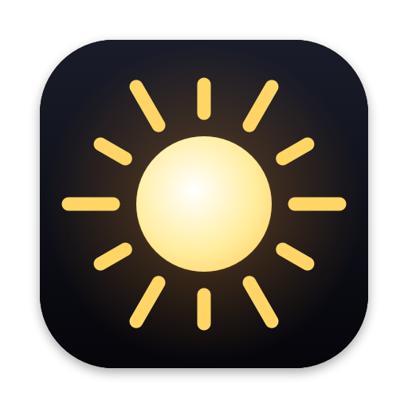
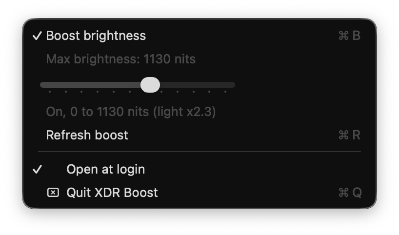

<p align="center">
  
</p>

<h1 align="center">XDR Boost</h1>

<p align="center">
  Let everyday apps use the extra brightness of your MacBook Pro's XDR display, not just HDR video.
</p>

<p align="center">
  <a href="https://github.com/RoshanManjaly/xdr-boost/releases/latest"></a>
  
  
  <a href="LICENSE"></a>
</p>

<p align="center">
  <a href="#install">Install</a> ·
  <a href="#use">Use</a> ·
  <a href="#faq">FAQ</a> ·
  <a href="docs/HOW-IT-WORKS.md">How it works</a> ·
  <a href="docs/MEASUREMENTS.md">Measurements</a>
</p>

<p align="center">
  
</p>

MacBook Pros with a Liquid Retina XDR display hold normal content to 500 nits. The panel can reach
1,600 nits, but macOS keeps that range for HDR video and photos. XDR Boost lets everything on
screen use it. It's a menu-bar app with under 400 lines of Swift.

- Turn it on and off from the menu bar. Quitting puts the display back to normal.
- Pick the top brightness from 500 to 1,600 nits. The default, 1,130, keeps large bright areas
  near the panel's full-screen ceiling, so colors stay clean.
- Auto-brightness keeps working, because the boost scales whatever the brightness slider is doing.
- It turns itself off in Low Power Mode or at 20% battery or less. You can turn it back on.
- It opens at login unless you turn that off.
- Public macOS APIs only, MIT licensed.

## Install

```bash
curl -fsSL https://raw.githubusercontent.com/RoshanManjaly/xdr-boost/main/install.sh | bash
```

This downloads the latest release, installs `XDRBoost.app` to `~/Applications` and starts it.
[install.sh](install.sh) is short if you want to read it first.

Then click the sun icon in the menu bar and turn on **Boost brightness**. The screen gets brighter
over about 2 seconds.

You need an Apple silicon MacBook Pro with an XDR display (14- or 16-inch, 2021 or later) and
macOS 14 or later. On other Macs the app runs but says "No XDR display on this Mac".

To install by hand, download `XDRBoost.zip` from
[Releases](https://github.com/RoshanManjaly/xdr-boost/releases/latest), unzip it and run
`bash ~/Downloads/XDRBoost/install.sh`. Set `XDRBOOST_DEST` to install somewhere other than
`~/Applications`.

XDR Boost is ad-hoc signed, not notarized by Apple. Both install routes get past Gatekeeper on
their own. If you copy the app somewhere yourself and macOS refuses to open it, run
`xattr -dr com.apple.quarantine /path/to/XDRBoost.app`, or use **Open Anyway** in System Settings
> Privacy & Security.

## Use

Click the sun icon in the menu bar. A menu bar manager such as Bartender or Ice may hide it at
first.

| Menu item | What it does |
|---|---|
| Boost brightness | Turns the boost on or off. The icon fills in while it's on. |
| Max brightness | Slider from 500 to 1,600 nits. 1,130 is the default. 1,600 gives the brightest highlights. |
| Refresh boost | Applies the slider now (otherwise it applies when the menu closes). It also brings the boost back if it drops out after sleep. |
| Open at login | On by default. |

If the boost turns itself off, the grey status line under the slider says why.

## FAQ

### Is it safe for my display?

XDR Boost doesn't touch firmware or private display settings. It shows a tiny HDR window and scales
the gamma table, both through public APIs, and macOS stays in charge of the backlight. Brighter
means more heat and battery use, and macOS may dim the panel if it gets too warm. There is
no warranty, as the [license](LICENSE) says.

### Why doesn't a full white screen reach 1,600 nits?

The panel can't hold that across the whole screen. 1,600 nits is a peak for part of the screen. A
full white screen measured about 1,100 nits for XDR Boost at 1,600 and for native HDR alike, and the panel's
own HDR preset lists 1,000 nits full-screen sustained.

### Why is the default 1,130 and not 1,600?

1,130 gives a factor of x1.42. That keeps large bright areas near the panel's ~1,100-nit
full-screen ceiling instead of past it, so colors stay clean. It's also the level I liked best day
to day. Move the slider to 1,600 if you want the brightest highlights.

### Can I run it alongside other display apps?

Not with another app that writes the gamma table, such as another brightness booster. Both undo
each other. If another app keeps resetting the table, XDR Boost turns itself off and the status line
names the likely cause.

### Does it work with f.lux, Night Shift or calibration tools?

They can change the same gamma table, so they may conflict with the boost.

### Will it work on my Mac?

It's been tested on one Mac (below). Other 14- and 16-inch XDR MacBook Pros should work, but the
nit numbers may differ. If you try it, a
[compatibility report](https://github.com/RoshanManjaly/xdr-boost/issues/new?template=compatibility.yml)
helps the next person.

## Measured results

Light ratios measured with a second MacBook's ambient light sensor, converted to nits by taking
normal white as 500 nits. Brightness slider at 100%. Method and raw numbers:
[docs/MEASUREMENTS.md](docs/MEASUREMENTS.md).

| Setting | 25% of the screen white | Full screen white |
|---|---|---|
| Boost off | 500 nits | 500 nits |
| XDR Boost at 1,130 (default) | ~1,080 nits | ~1,060 nits |
| XDR Boost at 1,600 | ~1,600 nits | ~1,090 nits |
| Native HDR, for comparison | ~1,610 nits | ~1,100 nits |

## How it works

A 2 x 2 point HDR window makes macOS open up the panel's HDR headroom. The display's gamma table is
then scaled so normal content uses that headroom, by a factor taken from a measured curve so bright
colors don't clip. Details: [docs/HOW-IT-WORKS.md](docs/HOW-IT-WORKS.md).

## Background

I wanted my MacBook Pro's display above 500 nits for everyday work.

I built XDR Boost in Claude Code with the REA reverse-engineering toolkit. I worked out how macOS
grants HDR headroom, then tested on the panel. My first version scaled the gamma table by the full
headroom (x3.2) and washed out colors. To find out why, I pointed a second MacBook at the
screen and used its ambient light sensor as a light meter and its webcam to check colors. That
turned up three things:

- The gamma table is gamma-encoded, so light rises as factor ^ 2.32. A factor of x3.2 asked for
  about 15x the light, and bright colors clipped.
- On macOS 26, gamma tables built from a 1,024-entry read were ignored. 256 entries work.
- A full white screen stopped near 1,100 nits for every method I tried, native HDR included.
  1,600 nits only shows on part of the screen.

The commit history follows the same steps, from the first prototype to the current release.

## Tested on

- MacBook Pro 16-inch (2021), Apple M1 Max (MacBookPro18,2), built-in Liquid Retina XDR display
- macOS 26.7.2 (25G332)

## Limits

- Only the built-in XDR display is boosted. External displays are left alone.
- HDR video probably loses some highlight detail while the boost is on. I haven't measured it.
- The nit values come from a light sensor and a 500-nit reference, not a calibrated meter.

## Build from source

You need the Xcode command line tools (`xcode-select --install`).

```bash
./build.sh               # build and install to ~/Applications
./build.sh --no-install  # build only, to build/XDRBoost.app
./package.sh             # build/XDRBoost.zip, the release asset
```

The tools used for the measurements are in [tools/](tools/).

## Uninstall

```bash
curl -fsSL https://raw.githubusercontent.com/RoshanManjaly/xdr-boost/main/dist/uninstall.sh | bash
```

This quits the app, removes the login item, deletes `~/Applications/XDRBoost.app` and clears its
settings. The release zip has the same script as `uninstall.sh`.

## Contributing

Bug reports and compatibility reports help most right now. The issue forms ask for your Mac model
and macOS version. Pull requests are welcome. Please say which Mac you tested on. For security
problems, see [SECURITY.md](SECURITY.md).

## Credits

- [BrightIntosh](https://github.com/niklasr22/BrightIntosh) by Niklas Rousset, a useful reference
  for the HDR window technique. No BrightIntosh code is included.

## License

[MIT](LICENSE)
